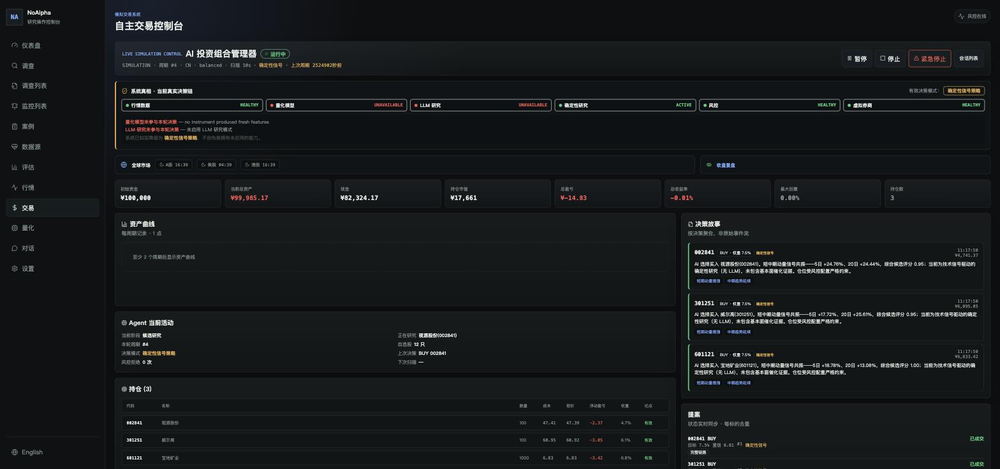
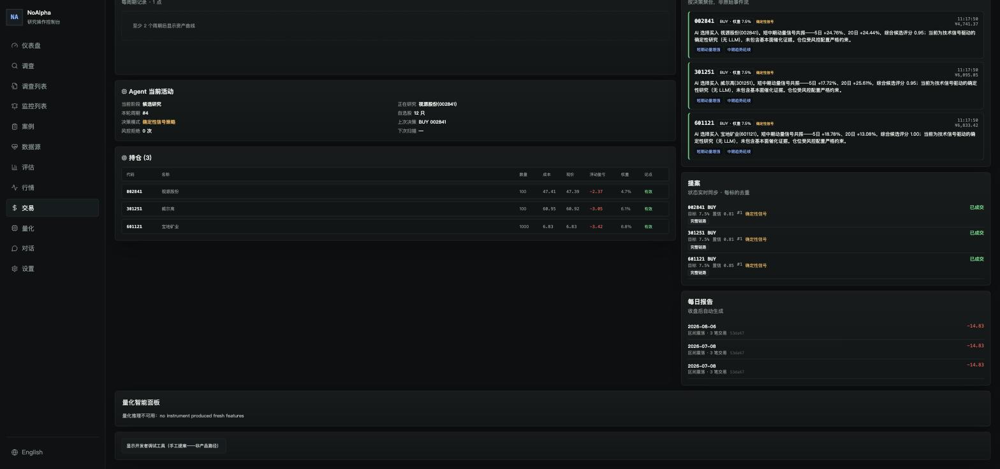
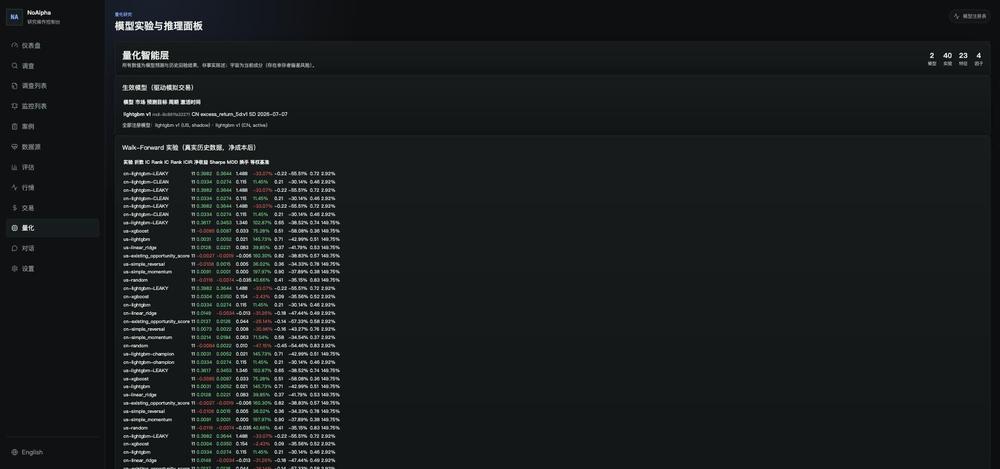
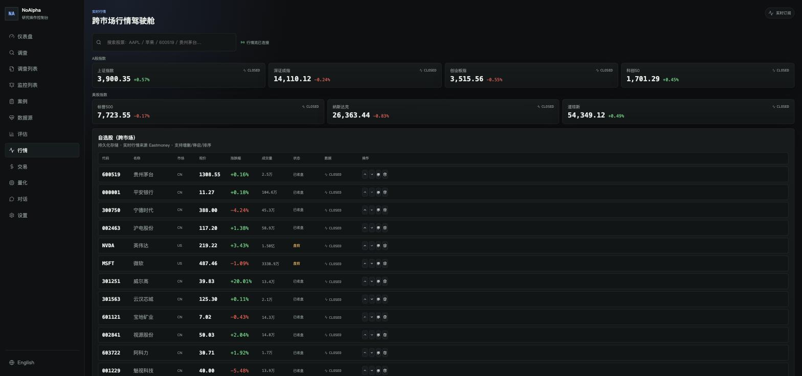

# NoAlpha

**为 LLM 交易研究提供可信的度量层。**

绝大多数 AI 交易项目**无法告诉你它的超额收益是不是真的**。回答这个问题所需要的工具——point-in-time 纪律、泄漏检测、LLM 贡献的诚实归因——要么缺失，要么被想当然。本项目就是这套工具，外加一个可运行的 A 股 / 美股研究与模拟交易系统。

**为什么叫 "NoAlpha"？** 因为宣称 alpha 很容易，证明 alpha 很难。这个项目拒绝宣称它无法证明的东西——**包括关于它自己的**。

[English](README.md) · MIT 协议

---



> **这张图里最重要的不是净值，是那两个红色的 `UNAVAILABLE`。**
> 系统在自己的界面上承认：这一轮决策里，量化模型没有产出新特征、LLM 研究没有启用，
> 它已如实降级为确定性信号策略——而不是假装用了它并没有用上的能力。
> 大多数系统会把这行字藏进日志，这里它就在最显眼的地方。



> 每一笔持仓都能追到它的**决策故事**和**提案**：谁提的、依据什么信号、置信度多少、
> 用的是哪种决策模式。「量化推理不可用」也照样写在面板上，不做静默兜底。

| Walk-forward 实验：泄漏 vs 干净 | 跨市场行情驾驶舱 |
| :--- | :--- |
| [](docs/images/quant-walkforward.jpg) | [](docs/images/market-cockpit.jpg) |
| `cn-lightgbm-LEAKY` 的 Rank IC 是 **0.3644**，净收益却是 **−33.07%**；`cn-lightgbm-CLEAN` 的 Rank IC 只有 **0.0274**，净收益 **+11.45%**。同一份代码、同一段历史，差别只在一个泄漏开关——漂亮的 IC 可以完全不换来钱。 | A 股四大指数 + 美股三大指数 + 自选股实时报价，行情源逐条标注（Eastmoney / 收盘 / 盘前）。数据新鲜度和延迟秒数是接口的一等字段，不是事后补的注释。 |

---

## 这个项目新在哪

以下四件事，我们在现有开源交易项目里没有找到对应实现：

### 1. Forward-only LLM 特征采集

守住 LLM 的**输入**是不够的。你今天问 LLM 它在 2024 年怎么看一只股票，它不会从你给的证据推理——它**回忆**发生了什么，因为结果就在它的预训练语料里。文献称之为 **parametric look-ahead（参数性前视）**，这是 2026 年的活跃研究问题：

- [Detecting Lookahead Bias in LLM Forecasts](https://arxiv.org/abs/2512.23847) —— 模型能逐字复现训练截止前的价格
- [Look-Ahead-Bench](https://arxiv.org/abs/2601.13770) —— 通用模型存在显著时间偏差
- [Chronologically Consistent LMs](https://arxiv.org/pdf/2510.11677) —— 用时间戳切断的语料重训来缓解

学术界的方案是**重训模型**，这对绝大多数实践者不可及。`noalpha/quant/llm_features.py` 走工程路线：一个 append-only 存储，`available_at` 是一次真实 LLM 调用的墙钟完成时间，并且**拒绝补写历史**。补写的记录被强制标为 `pit_safe=false`，排除在就绪计数之外。

它很慢——就绪时间以月计而非分钟计——而且据我们所知，**这是该纪律唯一的开源实现**。

### 2. 一个能伪造出自身欺诈的回测系统

```bash
python experiments/leakage_demo.py
```

两个完全相同的 LightGBM，完全相同的 purged walk-forward 折，完全相同的真实 A 股日线。只换一个 label：

```
                           Rank IC   Rank ICIR    net return    sharpe
  ────────────────────────────────────────────────────────────────────
  clean protocol           +0.0274      +0.115       +11.45%     +0.21
  leaky same-bar           +0.3644      +1.488       -33.07%     -0.22

  Rank IC inflation: 13.3x
```

`close[T+4]/close[T-1]` 是公开回测代码里最常见的 label 写法之一。它跨越了决策日 `T`，而模型自己的 `return_1d` 特征在 `T` 收盘时**已经知道**这一天涨跌了。它看起来好 **13 倍**，实际亏掉三分之一。

泄漏一旦不再复现，demo 就以非零码退出——所以它是 PIT 机制的**回归测试**，不是一张截图。

### 3. 真正能度量 LLM 贡献了什么的基础设施

三条臂跑在同一行情、同一成本假设、同一周期时序上：`quant_only`、`deterministic_hybrid`、`llm_hybrid`。只有一条驱动券商，其余为影子组合。每一次分歧都带 `llm_changed_decision` 落盘，于是 **LLM 的贡献是一个可归因的数字，而不是一种感觉**。

大多数项目回答不了"LLM 到底有没有用"，因为它们从未跑过那个反事实。这个项目是为此而建的。

### 4. 晋级是门禁，不是习惯

`EXPERIMENTAL → VALIDATED → SHADOW → PAPER → ACTIVE`，逐级推进，代码强制。训练完一个模型永远不等于激活它。美股模型没跑赢基准，于是它停在 `SHADOW` 且**不参与交易**——这是门禁在正常工作，不是疏漏。

相关设计：**LLM 永远不下单。** 它输出结构化信号，进入一个版本化的确定性融合策略，该策略可以降权或否决，但不能发起交易。代码库中**任何地方都不存在 "you are a trader" 提示词**——这是对主流 Agent-first 设计的反命题。

---

## 架构

| 层 | 模块 | 内容 |
|---|---|---|
| 行情 | `noalpha/market/` | 多主机 provider 回退链、交易所时间戳驱动的 freshness、交易日历 |
| 证据研究 | `noalpha/research/`, `pit.py` | Point-in-time 守卫、证据归一去重、时间线、事件检测、引用校验 |
| 量化 | `noalpha/quant/` | 版本化 label、purged walk-forward、实验存储、模型注册表 + 晋级门禁、校准、集成 |
| 交易 | `noalpha/trading/` | 自主循环、LLM 融合策略、硬风控、虚拟券商、三臂影子对照 |

Label 编码执行假设：`open[T+1+h]/open[T+1]-1`——`T` 收盘决策，`T+1` 开盘成交。同 bar 执行在**结构上不可能**，而不只是"不推荐"。

---

## 这套度量层测出了什么

真实 walk-forward，2019-01 → 2026-07，11 folds，expanding train 500d / valid 60d / test 120d / purge 11d，扣成本（佣金 5bp + 滑点 10bp，A 股另加卖出印花税 5bp）。

### A 股，top-5，5 日调仓

| 模型 | IC | Rank IC | Rank ICIR | 净收益 | Sharpe | MDD | 换手 |
|---|---|---|---|---|---|---|---|
| random | −0.006 | +0.002 | +0.01 | −47.2% | −0.45 | −54% | 0.83 |
| simple_momentum | +0.021 | +0.018 | +0.06 | **+71.5%** | +0.58 | −35% | 0.37 |
| simple_reversal | +0.007 | +0.002 | +0.01 | −31.0% | −0.16 | −43% | 0.76 |
| 原有启发式 (`opportunity_score`) | +0.014 | +0.013 | +0.04 | −26.1% | −0.14 | −57% | 0.58 |
| linear_ridge | +0.015 | −0.003 | −0.01 | −31.3% | −0.18 | −47% | 0.49 |
| **lightgbm**（冠军，ACTIVE） | +0.033 | +0.027 | +0.115 | +11.5% | +0.21 | −30% | 0.46 |
| xgboost | +0.030 | **+0.035** | **+0.154** | −2.4% | +0.09 | −36% | 0.52 |
| 等权基准 | — | — | — | +2.9% | +0.13 | −32% | 0 |

冠军模型在收益、回撤、换手上都胜过基准，在收益上输给一个五行动量规则。**这个取舍被记录下来而不是被藏起来——这正是先建度量层的意义。**

美股方面没有模型跑赢等权基准（+149.8%，Sharpe 1.02），因此没有任何模型被晋级到 `SHADOW` 之上。

### 加一层研究到底有没有用？

| 策略 | A 股 | 美股 |
|---|---|---|
| 纯量化（LightGBM） | **+11.5%** | **+145.7%** |
| 仅确定性研究代理 | −13.3% | +96.4% |
| 量化 + 确定性研究 | −1.8% | +13.4% |
| **量化 + 真实 LLM 研究** | *尚不可测* | *尚不可测* |

**这张表很容易被误读，请仔细看。** 被测到的混合臂用的是**确定性研究代理**（一个动量复述），**不是 LLM**。该代理与量化信号高度相关但噪声更大，融合后稀释了排名质量。

**真实 LLM 那一臂尚未被测量。** 它的影子对照当前报告 `INSUFFICIENT_SAMPLE`，前向采集仍在进行中。**任何人用这种证据告诉你 LLM 研究能不能带来 alpha——无论说能还是说不能——都是在过度宣称。我们不会这么做。**

目前观察到 LLM 层确实在做的事是**冲突拦截**：当量化与研究信号打架时，它降级为 reduce / no_action，而不是把两者平均掉。

---

## 在相信任何东西之前，请先读这些限制

1. **每个市场只有 24 只标的。** 24 只股票上的 Rank IC +0.027 统计功效很薄。请把这些数字看作"**协议**有效"的演示，而不是"**模型**有效"的证据。扩大 universe 是第一优先级的 open issue。
2. **存在幸存者偏差，且已标注。** universe 是今天的流动性标的，不是时点指数成分股。每个 dataset 都携带 `survivorship_bias_risk=true`。
3. **行情来自非官方接口**（Eastmoney / Sina / Tencent）。它们会限流、会无预告变更，其服务条款可能限制你的使用方式。本项目**没有任何商业数据授权**。非个人用途前请自行确认所在司法辖区与数据方条款。
4. **LLM 特征尚未进入任何模型**——这是设计使然，且几个月内都不会。
5. **没有验证过的实盘链路。** Alpaca adapter 存在，但从未交易过真实资金。
6. `citation_support` 在 2026-08 之前每次运行都返回 0.0（evidence-id 格式不匹配）。已修复并加了回归测试，但此日期之前记录的所有 LLM 融合结果都**低估**了研究信号。

---

## 快速开始

```bash
pip install -e ".[quant]"          # 核心安装不含 ML 依赖
cp .env.example .env               # 可选：填入 LLM key 以启用研究层
uvicorn noalpha.api:app --port 8000

cd frontend && npm install && npm run dev   # 控制台 http://127.0.0.1:5173
```

或者 `docker compose up`。

**配置说明。** `.env.example` 里的所有项都是可选的 —— 不填任何 key 时系统运行在确定性模式并**明确告知**，而不是偷偷假装用了 LLM。密钥解析优先级从高到低：

1. `.cache/api/credentials.json` —— Settings UI 里运行时配置，已 gitignore
2. 导出的环境变量 —— CI 和容器用这层
3. `.env` —— 本地开发用，已 gitignore

`.env` 永不提交；`.env.example` 记录了代码读取的每一个变量，**并有测试强制保证其完整性**。

### 复现

```bash
python experiments/leakage_demo.py                    # 13.3 倍虚假优势演示
python experiments/quant_phase_q.py --market cn       # 完整 7 模型 walk-forward
python -m evals.runners.autonomous_replay             # 历史回放，闭环决策
```

### 模拟交易

```bash
noalpha trading create --initial-capital 100000 --markets CN,US
noalpha trading run-once
noalpha trading status
```

### 测试

```bash
pytest tests/ -q     # 141 passed, 3 skipped
```

其中含 7 项 leakage attack 测试（主动尝试把未来信息偷渡过 PIT 守卫），以及硬不变量测试（已成交的 proposal 永远不可能报告为 pending）。

## 延伸阅读

- [`docs/adr/`](docs/adr/) —— 12 份架构决策记录：为什么暂时**否决**了 LangGraph、知识图谱、向量数据库
- [`docs/audit/phase_q_report.md`](docs/audit/phase_q_report.md) —— 上文结果表背后的完整 walk-forward 运行记录，含泄漏演示
- [`docs/audit/phase_q5_report.md`](docs/audit/phase_q5_report.md) —— LLM 融合工作，以及为什么 LLM 那一臂仍是 `INSUFFICIENT_SAMPLE`
- [`docs/research/deep_dives/`](docs/research/deep_dives/) —— 对 TradingAgents、Qlib、Lean、NautilusTrader、OpenBB、Freqtrade 等项目的源码级阅读

## 免责声明

研究与教育用途软件。**不构成任何金融、投资或交易建议。** 模拟结果不代表真实表现。不要用它碰真钱。
